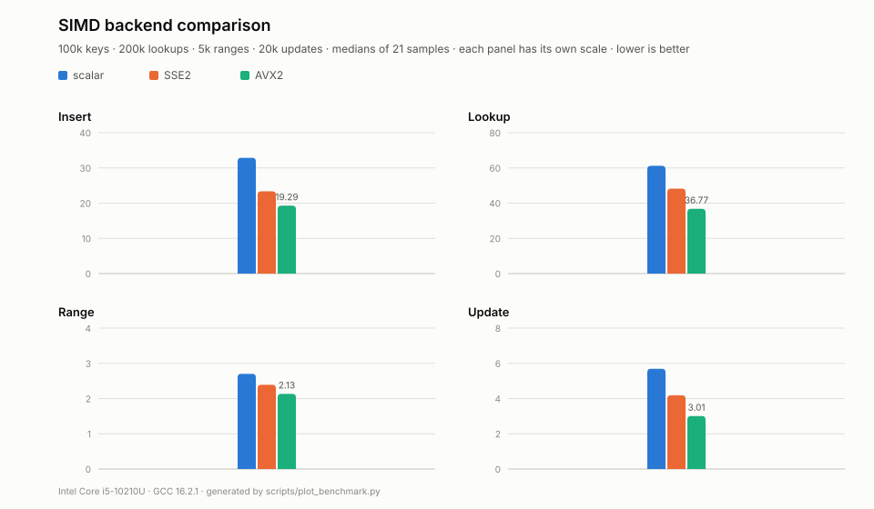

# Cache-line-sized B+ tree with SIMD node search

A small C++17 library built around `hft::CacheTree`, an insertion-only B+ tree
whose node layout is sized to one cache line, plus runtime-dispatched SIMD
search kernels. This is an experimental systems-programming project. It makes
no claims about production readiness, trading suitability, or tail latency;
the benchmark section reports per-machine observations with their caveats.

## Quickstart

Requires CMake 3.16 or newer and a C++17-compatible compiler.

```bash
git clone https://github.com/OskarKal/cache-btree.git
cd cache-btree
cmake -S . -B build -DCMAKE_BUILD_TYPE=Release
cmake --build build -j
cd build
ctest --output-on-failure
```

This builds the library and test suite, then runs the tests.

## Overview

- **`hft::CacheTree`** — insertion-only B+ tree. Inserting an existing key
  updates its value. Keys and values are signed 32-bit integers.
- **Cache-line-sized nodes** — node capacity is derived at compile time from
  the configured line size: `(line_bytes - 8) / 8`. A 32-byte line holds 3
  keys, 64 bytes holds 7, and 128 bytes holds 15.
- **Runtime SIMD dispatch** — scalar, SSE2, and AVX2 node-search kernels are
  selected at runtime via `__builtin_cpu_supports`, with a scalar fallback.
  Comparisons use signed `int32_t` ordering. Each vector kernel issues a masked
  full-width load, so AVX2 still vectorizes a 64-byte node (7 keys, 8 lanes):
  lanes at or beyond the node's key count are masked out, and the load stays
  inside the node object.
- **Configurable target** — `HFT_CACHE_LINE_SIZE` is fixed when CMake
  configures the build. It is detected on native Linux or supplied explicitly
  for cross-compilation. `HFT_SIMD` sets a compile-time SIMD ceiling
  (`SCALAR`, `SSE2`, `AVX2`, or `AUTO`); runtime detection still picks among
  the compiled backends.

Public API (`include/hft/cache_tree.hpp`):

```cpp
namespace hft {
class CacheTree {
public:
    explicit CacheTree(Backend backend = Backend::Auto);

    void insert(std::int32_t key, std::int32_t value);           // upsert
    std::optional<std::int32_t> find(std::int32_t key) const;
    std::vector<std::int32_t> range_search(std::int32_t start,
                                           std::int32_t max_count) const;
    std::size_t size() const;
    Backend backend() const;
    bool validate() const;  // structural invariants and alignment
};
}
```

## Layout

Repository layout:

```
CMakeLists.txt
cmake/config.hpp.in
include/hft/cache_tree.hpp
include/hft/simd_search.hpp
src/cache_tree.cpp
src/simd_search.cpp
tests/test_cache_tree.cpp
benchmark_both.cpp
scripts/plot_benchmark.py
docs/benchmark-light.svg, docs/benchmark-dark.svg
```

`include/hft/config.hpp` is generated into the build tree at
`generated/hft/config.hpp` during CMake configuration and defines
`HFT_CACHE_LINE_SIZE`. The `main` branch contains all of these paths;
other branches may contain only a subset.

## Architecture

### Node layout

Each node is exactly one cache line and is aligned to it. The key capacity is
derived at compile time:

```
C = (line_bytes - 8) / 8
```

```text
byte 0            4                                     4 + 4*C
+----------------+-------------------------------------+-----------------------------+
| metadata (u32) | keys[0..C-1] (int32, sorted)        | slots[0..C] (int32)         |
+----------------+-------------------------------------+-----------------------------+
```

The metadata's high bit is the leaf flag and the low 31 bits are the key count.
`slots` has `C + 1` entries:

- **Leaf:** `slots[0..count)` hold values; `slots[C]` is the next leaf index
  (0 terminates the chain). Leaves form a singly linked list in key order.
- **Internal:** `slots[0..count]` hold child indices; `keys[i]` is the first key
  of child `i + 1`. Routing uses `upper_bound`, so a key equal to a separator
  goes right; leaf lookup uses `lower_bound`.

| line bytes | key capacity `C` | slots | readable int32s from `keys` |
|---:|---:|---:|---:|
| 32 | 3 | 4 | 7 |
| 64 | 7 | 8 | 15 |
| 128 | 15 | 16 | 31 |

`sizeof(Node)`, `alignof(Node)`, and `offsetof(Node, keys)` are checked against
the configured line size with `static_assert`.

### Insert and split

Insertion walks from the root, recording node indices and child positions on a
fixed-size stack array; the depth is bounded by the 32-bit index space and a
minimum fanout of two (at most 32 levels). If the target leaf has room, entries
shift right and the key is inserted in order. Otherwise the node splits at
`(C + 1) / 2`, the separator is promoted, and the split cascades upward; a full
root is replaced by a new root with two children. Every node the cascade can
need is reserved before the tree is modified, so an allocation failure leaves
the tree unchanged.

### Range scans

`range_search(start, max_count)` finds the first leaf with `lower_bound`, copies
matching values, then follows `slots[C]` to the next leaf until it has
`max_count` values or reaches the end of the chain. After the first leaf the
scan never re-enters the internal levels.

### SIMD search

The vector kernels compare a full vector of keys at once. `keys` starts at byte
4, so `(line_bytes - 4) / 4` int32 values are readable from `keys` onward (the
key array plus the slot array). A vector load at the start of the key array
therefore stays inside the node object even when the node holds fewer keys than
the vector width. Lanes at or beyond `count()` are masked out before the result
is used; the scalar loop is used when a full vector does not fit in the readable
room. At a 32-byte line the AVX2 kernel falls back to scalar because 8 lanes do
not fit in the 7 readable int32s.

With capacity `C`, point lookup and insert take `O(log_C n)` node hops plus
`O(C)` work per node; a range scan returning `k` values takes
`O(log_C n + k)`.

## Build

Requirements: CMake 3.16 or newer and a C++17 compiler. Automatic cache-line
detection is native-Linux only; cross-compilation requires an explicit value.

```bash
cmake -S . -B build -DCMAKE_BUILD_TYPE=Release
cmake --build build -j
```

Targets:

- `hft_cache` — the library.
- `hft_tests` — the CTest suite.
- `hft_bench` — the benchmark.

## Tests

`tests/test_cache_tree.cpp` is a dependency-free CTest suite. It compares the
tree differentially against `std::map`, checks structural invariants through
`validate()`, exercises forced backends, and covers boundary keys and range
edges. It also tests the search primitive directly on standalone sorted arrays
of lengths 0..33 for every available backend, including padded `room` arrays
whose extra lanes must be masked; this executes the SSE2 and AVX2 vector loops
even when a tree node holds fewer keys than a vector. `validate()` is checked
against deliberately corrupted trees, so it cannot pass vacuously. The suite
asserts that `Auto` resolves to the highest available backend and that forced
unavailable backends are rejected.

```bash
cd build
ctest --output-on-failure
```

Verified on this machine (Intel i5-10210U, 64-byte L1 line, GCC 16.2.1): tests
passed at `HFT_CACHE_LINE_SIZE` 32, 64, and 128 with `HFT_SIMD` set to `AUTO`,
`SCALAR`, `SSE2`, and `AVX2`, and with `-DHFT_ENABLE_SANITIZERS=ON`. Sanitizer
failures abort (UBSan is built with `-fno-sanitize-recover=all`), so they fail
CTest. These results are specific to this machine and toolchain, not a
permanent guarantee.

## Benchmark

`hft_bench` compares the scalar, SSE2, and AVX2 backends on identical,
deterministically generated workloads, and includes `std::map`, a bulk-loaded
sorted `std::vector`, and `std::unordered_map` baselines built from the same
workload. Correctness is verified against a `std::map` oracle before timing and
again after updates; unavailable SIMD backends are skipped.
`std::unordered_map` has no ordered range query, so its range phase is reported
as not measured rather than emulated by sorting. The sorted vector is
bulk-loaded in the insert phase (append then one sort), so its insert time is
not comparable to incremental insertion; it is a static-data baseline for
lookups and ranges.

```bash
./build/hft_bench --output results.csv \
  --keys 20000 --lookups 40000 --ranges 2000 --updates 2000 --runs 3 --seed 42
```

Usage:

```
hft_bench --output PATH [--distribution uniform|zipf]
          [--backend all|scalar|sse2|avx2|std_map|sorted_vector|std_unordered_map]
          [--keys N] [--lookups N] [--ranges N] [--updates N] [--runs N]
          [--seed N] [--build-flags TEXT] [--reserve]
```

`--help` prints the same summary. Inserts always cover every `--keys` key
exactly once, so container size is the same for both distributions;
`--distribution` biases lookups, ranges, and updates. Zipf uses a fixed
exponent `alpha = 1.5`. `--backend` selects one target; the default `all` runs
every available SIMD backend plus the `std::map`, `sorted_vector`, and
`std::unordered_map` baselines, and a single target is useful with external
profilers. `--reserve` pre-sizes the `std::unordered_map` baseline with
`reserve(keys)`. `--seed` accepts 0. The output path is opened exclusively
before the timed runs, so an existing path or missing parent directory fails
immediately and is never overwritten.

### Results

Measured on an Intel Core i5-10210U (64-byte L1 line, GCC 16.2.1, Linux) with
100k keys, 200k lookups, 5k ranges, and 20k updates. Each cell is the median of
21 samples: 7 runs per invocation, 3 invocations, pinned to one CPU with
`taskset`.

| target | insert (ms) | lookup (ms) | range (ms) | update (ms) |
| --- | ---: | ---: | ---: | ---: |
| scalar | 32.87 | 61.20 | 2.70 | 5.69 |
| SSE2 | 23.37 | 48.25 | 2.39 | 4.19 |
| AVX2 | 19.29 | 36.77 | 2.13 | 3.01 |
| `std::map` | 42.35 | 96.62 | 7.68 | 8.12 |
| sorted `std::vector` | 12.05* | 42.99 | 1.22 | 3.57 |
| `std::unordered_map` | 14.51 | 11.05 | n/a | 1.01 |

\* Bulk load (append + one sort), not comparable to incremental insertion.

On this workload and machine, AVX2 is about 1.7× faster than scalar on insert
and lookup, 1.9× on updates, and 1.3× on ranges; it is 2.2–3.6× faster than
`std::map` across the four phases. The range comparison is conservative for
`CacheTree`: its `range_search` allocates a result vector per call, while the
STL baselines do not.

<picture>
  <source media="(prefers-color-scheme: dark)" srcset="docs/benchmark-dark.svg">
  
</picture>

Reproduce with:

```bash
for i in 1 2 3; do
  rm -f "results-$i.csv"
  taskset -c 2 ./build/hft_bench --output "results-$i.csv" \
    --backend all --keys 100000 --lookups 200000 --ranges 5000 \
    --updates 20000 --runs 7 --seed 42
done
python3 scripts/plot_benchmark.py \
  --input results-1.csv results-2.csv results-3.csv --out-dir docs
```

`taskset` is Linux-specific; drop it on other systems. These are
single-machine microbenchmarks, not production or latency claims. Point
lookups favor hash tables and static range scans favor a bulk-loaded sorted
vector; this structure targets dynamic ordered range queries.

A range-heavy run exercises the ordered structure rather than point lookups:

```bash
./build/hft_bench --output ranges.csv \
  --keys 20000 --lookups 2000 --ranges 40000 --updates 200 --runs 3 --seed 42
```

Node size is a compile-time choice and changes the depth/scan tradeoff. The
default is the detected L1 line size (64 bytes on the machine used here, 7 keys
per node). In local measurements, 128-byte nodes (15 keys) were faster for
lookups and ranges because the tree was shallower; 32-byte nodes (3 keys) were
substantially worse. At 32 bytes the AVX2 kernel also falls back to scalar
because a full 8-lane load does not fit in the node's readable key storage.
Configure with `-DHFT_CACHE_LINE_SIZE=128` to measure a variant. These are
observations on one machine, not permanent recommendations.

The CSV written to `--output` records machine and build metadata (CPU,
compiler, supplied build flags, cache-line size, SSE2/AVX2 availability),
workload parameters, backend, whether the range phase was measured
(`range_measured`), run number, phase-total timings in milliseconds, and a
checksum. Backend order rotates between runs to reduce drift bias. Timings are
per-machine observations, not performance claims; whether a SIMD backend
vectorizes depends on the node capacity and the number of keys in the node.
The STL baselines are measured under the same workload. The
`std::unordered_map` baseline is not pre-sized unless `--reserve` is passed,
and the sorted vector's insert phase is a bulk load rather than incremental
insertion. The checksum covers lookup results and, where the range phase was
measured, range results, so it is comparable only among targets that ran the
same phases (all except `std_unordered_map`).

## Configuration

| Option | Meaning |
| --- | --- |
| `HFT_CACHE_LINE_SIZE` | Empty (default) detects the native Linux L1 data/unified line size. An explicit byte count is required when cross-compiling. Must be a power of two between 32 and 268435456 and supported by the compiler's alignment. |
| `HFT_ENABLE_SANITIZERS` | Builds with AddressSanitizer and UndefinedBehaviorSanitizer (GCC/Clang only). UBSan is non-recoverable, so findings fail the test run. |
| `HFT_SIMD` | Compile-time SIMD ceiling: `AUTO`/`AVX2` keep SSE2 and AVX2, `SSE2` disables AVX2, `SCALAR` disables both. Runtime detection still chooses among the compiled backends. Default `AUTO`. |
| `HFT_BUILD_BENCHMARK` | Builds `hft_bench` when its sources are present (default `ON`). |

The cache-line size is a compile-time choice: it determines node layout and is
baked into the generated header and binary. A binary must be reconfigured and
rebuilt for a different target line size. SIMD has both a compile-time ceiling
(`HFT_SIMD`) and runtime selection, with scalar fallback when a vector backend
is unavailable on the CPU or was compiled out.

## Limitations

- Insertion-only: there is no erase, rebalancing policy beyond splits, or
  concurrency support.
- Keys and values are signed 32-bit integers; the implementation is
  single-threaded.
- Correctness is covered by the test suite on the tested configurations; there
  is no fuzzing campaign or formal verification.
- No latency, throughput, or suitability guarantees are made for any workload.
  The benchmark's point-lookup phases favor hash tables, and a bulk-loaded
  sorted vector can be faster for static range queries; this structure targets
  dynamic ordered range queries and ordered iteration.
- The cache-line size is compile-time; rebuild for each target. SIMD
  availability depends on the compiler, architecture, `HFT_SIMD` ceiling, CPU,
  and OS-enabled register state.
